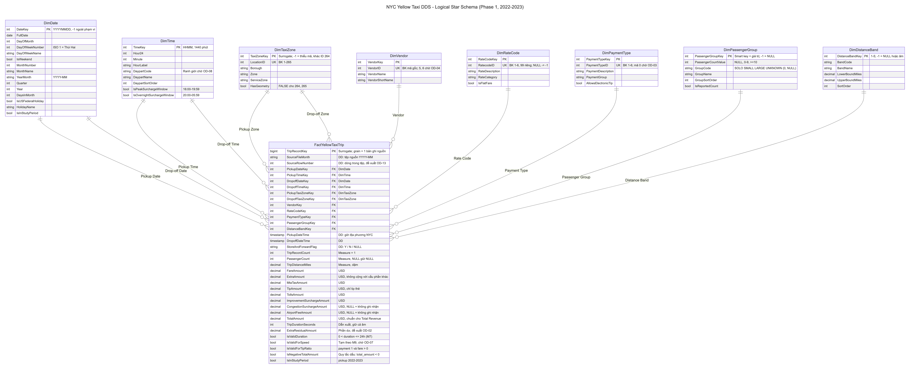

# Logical Model → Requirement Mapping (Phase 1)

**Tác giả:** Lộc
**Người nhận:** Trực, để đối chiếu với physical spec trong `physical_model_coverage.md`
**Nguồn yêu cầu:** đề bài CSC12107 (yêu cầu cơ bản 1–8, mở rộng 1–5), [requirements_traceability.md (Phúc)](../phuc/requirements_traceability.md), [analysis_grain_matrix.md (Phúc)](../phuc/analysis_grain_matrix.md)
**Mô hình:** [Fact](fact_yellow_taxi_trip_logical.md), [Reference dims (Dũng)](../dung/reference_dimensions_logical.md), [Supporting dims](supporting_dimensions_logical.md), [Sơ đồ (Mermaid)](dds_logical_model.mmd)

> **Quy ước:**
> - `F.` = thuộc tính của `FactYellowTaxiTrip`. Vai trò chiều ghi trong ngoặc, ví dụ `DimTaxiZone (Pickup)` nghĩa là nối qua `F.PickupTaxiZoneKey`.
> - **Mọi truy vấn mặc định lọc `F.IsInStudyPeriod = TRUE`.**
> - **`TripCount`** = định nghĩa Trip Count mà Phúc sẽ chốt ở [OD-01](logical_model_decisions.md). Mô hình đã hỗ trợ Trip Record Count (`SUM(F.TripRecordCount)`) và Operational Trip Count (`SUM(F.TripRecordCount)` với `F.IsNegativeTotalAmount = FALSE`). Net Trip Count cần bổ sung cờ (xem [grain §4.1](fact_grain_and_process.md#41-trip-count-chưa-chốt-od-01)).
> - **Trạng thái:** ✅ đủ; ⚠️ đường đi trong mô hình đã đủ nhưng kết quả còn phụ thuộc một điểm mở.

---

## 1. Yêu cầu cốt lõi C1–C8

| ID | Measures trong Fact | Chiều (vai trò) | Đường roll-up | Dẫn xuất / bộ lọc | Trạng thái |
|:---|:---|:---|:---|:---|:---:|
| **C1** Chuyến và khách theo ngày → tháng → năm | `F.TripRecordCount`, `F.PassengerCount` | `DimDate (Pickup)` | `Year → Quarter → Month → Day` | `TripCount`; `SUM(PassengerCount)` tự bỏ qua NULL; nhóm UNKNOWN trong `DimPassengerGroup` nếu cần tách | ⚠️ OD-01 |
| **C2** Doanh thu theo borough × vendor × thời điểm | `F.TotalAmount`, `F.FareAmount`, `F.TripRecordCount` | `DimTaxiZone (Pickup; Drop-off tùy chọn)`, `DimVendor`, `DimDate (Pickup)`, `DimTime (Pickup)` | Địa lý `Borough → Zone`; thời gian `Year → Month → Day → Hour` | Revenue = `SUM(TotalAmount)` (D-09). Đề bài nêu CMT, VTS; VendorID 5/6 (0,09%) hiển thị là thành viên riêng (OD-04) | ⚠️ OD-04 |
| **C3** Số chuyến theo hình thức thanh toán × borough × tháng | `F.TripRecordCount` | `DimPaymentType`, `DimTaxiZone (Pickup)`, `DimDate (Pickup)` | `PaymentGroup → PaymentDescription`; `Borough → Zone`; `Year → Month` | `% Payment Share = TripCount(payment) / TripCount(borough, tháng)`. Mã 0 (3,43%) phải hiển thị riêng (OD-03, OD-12) | ⚠️ OD-01, OD-03 |
| **C4** Đón và trả theo khung giờ / thứ / tháng | `F.TripRecordCount` | **Truy vấn 1:** `DimDate (Pickup)` + `DimTime (Pickup)`. **Truy vấn 2:** `DimDate (Drop-off)` + `DimTime (Drop-off)` | `Daypart → Hour`; `DayOfWeek`; `Year → Month` | Pickup Count và Drop-off Count là hai lần tổng hợp riêng trên cùng Fact, qua hai cặp khóa khác nhau, rồi đặt cạnh nhau. Không cộng hai số này | ⚠️ OD-01, OD-08 |
| **C5** Chuyến theo nhóm khách × biểu giá × cự ly | `F.TripRecordCount`, `F.PassengerCount`, `F.TripDistanceMiles` | `DimPassengerGroup`, `DimRateCode`, `DimDistanceBand` | `GroupName → PassengerCountValue`; `RateCategory → RateDescription`; `Band` (→ dặm thật trong Fact) | `Avg Distance = SUM(TripDistanceMiles) / TripCount`. Khối thiếu metadata rơi vào UNKNOWN ở cả nhóm khách lẫn biểu giá (OD-12) | ⚠️ OD-01, OD-09 |
| **C6** Vận hành theo borough/zone | `F.TripRecordCount`, `F.TotalAmount`, `F.FareAmount`, `F.TripDistanceMiles` | `DimTaxiZone (Pickup)` và `DimTaxiZone (Drop-off)`, `DimDate (Pickup)` | `Borough → Zone → LocationID`; `Year → Month` | `Avg Fare`, `Avg Distance` tính từ tổng. `Net Flow(zone) = PickupCount(zone) − DropoffCount(zone)` (hai lần tổng hợp như C4) | ⚠️ OD-01 |
| **C7** Top N tuyến phổ biến | `F.TripRecordCount`, `F.TotalAmount`, `F.TripDurationSeconds` | `DimTaxiZone (Pickup)` × `DimTaxiZone (Drop-off)` | Cặp Zone → cặp Borough | Nhóm theo cặp **có thứ tự** `(PickupTaxiZoneKey, DropoffTaxiZoneKey)`; `DENSE_RANK` theo `TripCount`. Avg Duration = `SUM(TripDurationSeconds)/COUNT` với `IsValidDuration`. Có 49.932 cặp quan sát | ⚠️ OD-01 |
| **C8** Tổng doanh thu và cấu phần | `F.TotalAmount`; cấu phần `F.FareAmount`, `F.ExtraResidualAmount`, `F.MtaTaxAmount`, `F.TipAmount`, `F.TollsAmount`, `F.ImprovementSurchargeAmount`, `F.CongestionSurchargeAmount`, `F.AirportFeeAmount` | `DimDate (Pickup)` | `Year → Quarter → Month` | Tổng doanh thu = `SUM(TotalAmount)`, đủ ngay. Phân rã cấu phần: không cộng `ExtraAmount` gốc cùng các cấu phần khác; `ExtraResidualAmount` là phần dư đề xuất | ✅ tổng / ⚠️ cấu phần (OD-02) |

## 2. Yêu cầu mở rộng E1–E5

| ID | Measures trong Fact | Chiều (vai trò) | Đường roll-up | Dẫn xuất / bộ lọc | Trạng thái |
|:---|:---|:---|:---|:---|:---:|
| **E1** Tip ratio và tốc độ theo biểu giá | `F.TipAmount`, `F.FareAmount`, `F.TripDistanceMiles`, `F.TripDurationSeconds`, `F.TripRecordCount` | `DimRateCode` | `RateCategory → RateDescription → RatecodeID` | Tip ratio = `SUM(TipAmount)/SUM(FareAmount)` với `IsValidForTipRatio`. Speed = `SUM(TripDistanceMiles)/(SUM(TripDurationSeconds)/3600)` với `IsValidForSpeed`. Không lấy trung bình của tỷ lệ đã tổng hợp | ⚠️ OD-07 |
| **E2** Tháng 5 so với tháng 6 và nguyên nhân | `F.TotalAmount`, `F.TripRecordCount`, `F.TripDistanceMiles`, `F.TripDurationSeconds` và các cấu phần | `DimDate (Pickup)`, `DimTaxiZone (Pickup)`, `DimRateCode`, `DimVendor`, `DimTime (Pickup)` | `Year → Month (5 vs 6)` → phân rã theo Borough, RateCode, Hour | Revenue = TripCount × Revenue/Trip (QĐ7). Chuẩn hóa theo ngày bằng `DimDate.DaysInMonth` (31 vs 30). Làm riêng cho 2022 và 2023. Chỉ giải thích bằng yếu tố nội tại của dữ liệu | ⚠️ OD-01 |
| **E3** Doanh thu/chuyến tăng khi số chuyến đi ngang | Như C8, cộng `F.TripDistanceMiles`, `F.TripDurationSeconds` | `DimDate (Pickup)`, `DimRateCode`, `DimTaxiZone (Pickup)` | `Year → Quarter → Month` | Rev/Trip = Σ cấu phần / TripCount (QĐ8). Profile ghi nhận mức `improvement_surcharge` 0,30 → 1,00 (12/2022) và `airport_fee` 1,25 → 1,75 (04/2023), cả hai đọc được qua cấu phần theo tháng | ⚠️ OD-01, OD-02 |
| **E4** MoM / YoY | Mọi measure cộng dồn | `DimDate (Pickup)` | `Year → Month` (`YearMonth`) | Đủ 24 tháng trọn vẹn: 01/2022 không có MoM; cả năm 2022 không có YoY trong tập chọn. Khi cần so sánh like-for-like theo ngày, dùng `DaysInMonth` | ✅ doanh thu / ⚠️ số chuyến (OD-01) |
| **E5a** Bản đồ đón/trả | `F.TripRecordCount` | `DimTaxiZone (Pickup)`, `DimTaxiZone (Drop-off)` | `Borough → Zone → LocationID` | Nối polygon theo `LocationID` khi `HasGeometry = TRUE` (ID 1–263). ID 264/265 hiển thị ở bảng phụ, không vẽ. Net Flow tính như C6 | ⚠️ OD-01 |
| **E5b** Doanh thu theo borough qua các tháng và xu hướng theo khung giờ | `F.TotalAmount`, `F.TripRecordCount` | `DimTaxiZone (Pickup)`, `DimDate (Pickup)`, `DimTime (Pickup)` | `Borough`; `Month`; `Daypart → Hour` | | ⚠️ OD-08 |

**Tổng kết:** 13/13 yêu cầu đều có đường đi trong mô hình, và không yêu cầu nào thiếu dữ liệu nguồn. Các dấu ⚠️ phản ánh **định nghĩa chỉ số** chưa chốt, không phải thiếu cấu trúc.

## 3. Kiểm tra tổng thể (tiêu chí nghiệm thu của overview)

| Tiêu chí ([phase1_overview.md](../../../plans/phase1/phase1_overview.md)) | Đáp ứng ở đâu |
|:---|:---|
| Mỗi yêu cầu map tới Fact, measures, vai trò chiều và phân cấp | Bảng §1, §2 |
| Grain tường minh; pickup/drop-off là các vai trò date/time/location riêng | [fact_grain_and_process.md](fact_grain_and_process.md) §2, §5 |
| Chỉ số có đơn vị và quy tắc tổng hợp; không lấy trung bình của trung bình | [Fact §4–§5](fact_yellow_taxi_trip_logical.md#4-measures-gốc) |
| Phát hiện nguồn ghi rõ 2022–2023 và gắn nhãn đo / TLC / suy luận / mở | [selected_data_profile_observed.md](selected_data_profile_observed.md) |
| Lookup/shapefile mismatch và câu hỏi tên vendor hiển thị trong quyết định | D-06, OD-04, OD-06 trong [logical_model_decisions.md](logical_model_decisions.md) |
| Có sơ đồ conceptual và logical | Logical: [dds_logical_model.png](dds_logical_model.png). Conceptual: bản nháp [dds_conceptual_model.png](dds_conceptual_model.png), chờ Dũng duyệt (OD-15) |

## 4. Việc Trực cần xác nhận ở mức vật lý

1. Mọi khóa ngoại trong §1–§2 tồn tại với đúng tên vai trò: 6 khóa role-playing, cộng `VendorKey`, `RateCodeKey`, `PaymentTypeKey`, `PassengerGroupKey`, `DistanceBandKey`.
2. Kiểu dữ liệu đủ chứa các giá trị quan sát được:
   - tiền âm, tới hàng nghìn USD;
   - cự ly tới 389.678,46 dặm;
   - `TripDurationSeconds` âm và lớn hơn 24 giờ;
   - drop-off tới năm 1970 (timestamp gốc).
3. NULL được phép ở `PassengerCount`, `CongestionSurchargeAmount`, `AirportFeeAmount`, `StoreAndForwardFlag`. Mọi khóa ngoại NOT NULL nhờ thành viên đặc biệt.
4. Quyết định có lưu `SourceRowNumber` hay không (OD-13), và quy ước đặt tên (OD-14).
5. Kết quả của OD-01 … OD-15 được phản ánh vào `dds_model_decisions.md`.
